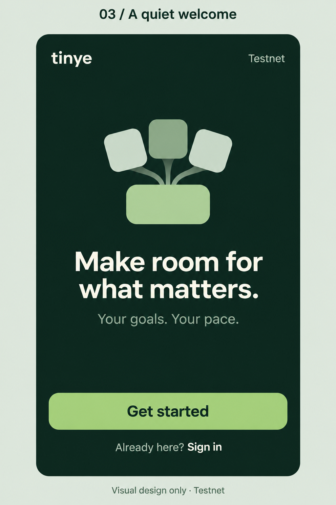

# Selected onboarding: A quiet welcome

**Status:** Approved - entrance design; implementation pending | **Version:** 1.0 | **Last updated:** 2026-11-14  
**Responsible role:** Product designer / frontend lead

## Purpose and approval

The owner selected option 3, **A quiet welcome**, on 2026-11-14. Use this as Tinye's default onboarding entrance. Preserve the locked friendly green identity and the uncluttered composition; the rejected crowded onboarding board and options 1, 2 and 4 are not the entrance baseline.

Reference SHA-256: `8769774dab009190d13b35b45e880423c5732fd7aa0b291b7420b3297175be53`.

## Assumptions and dependencies

This is scoped approval of the entrance's appearance and hierarchy, not application implementation, an authentication method, a wallet provider, legal terms or deployment. [design.md](../../design.md) governs exact flat colours/type; [ui.md](../../ui.md) governs accessibility and shared interactions. The raster image is a visual reference, not code or a completed Lottie asset. The lowercase wordmark remains provisional.

## Exact screen contract

| Element | Requirement |
|---|---|
| Background | Matte dark forest #10281E; no decorative scene |
| Header | Small lowercase tinye left, accurate Testnet label right |
| Illustration | One compact original group of rounded purpose tiles assembling into one goal card; sage/fresh-green palette |
| Headline | Make room for what matters. |
| Supporting line | Your goals. Your pace. |
| Primary action | Get started |
| Returning-user link | Already here? Sign in |
| Hierarchy | Illustration, short headline, single supporting line, generous breathing room, bottom action |

No progress dots, step counters, checklists, wallets, balances, terms checkboxes, extra feature cards or app bottom navigation on the welcome screen. Outside-board labels and the preview footer in the image are presentation furniture, not live UI elements. Retain the environment badge where applicable. Do not hardcode a fixed-height screenshot: let content scroll and keep actions usable with safe-area insets and enlarged text.

## Entry and next actions

Get started opens the next focused setup stage defined by [ONBOARDING_FLOW.md](ONBOARDING_FLOW.md). Sign in opens the approved returning-user authentication flow. Authentication/wallet model remains a separate decision; do not invent email/social options from this visual selection.

Required agreements, risk information and wallet/key-control education remain dedicated readable stages before financial participation. The owner rejected crowding, not required disclosure. Each subsequent screen has one task, one headline and one primary action. Show essential consequences at the relevant step rather than combining all education into the welcome screen. Notifications remain contextual and optional, not part of the initial welcome.

## Lottie-style motion brief

**Asset ID:** `onboarding-welcome-tiles`. Original vector motion, inspired by the lightweight illustration approach discussed for LottieFiles; no third-party animation has been selected, licensed, downloaded or claimed as created.

| Time | Intended motion |
|---|---|
| 0-250ms | Purpose tiles appear gently at small separated positions |
| 250-1000ms | Tiles move a short distance towards the goal-card composition |
| 1000-1400ms | Composition settles without overshoot; hold a clear final pose |

Play once on first welcome entry; no infinite loop, confetti, sound, glowing effect, pulsing CTA or forced delay. Keep text/buttons stationary and immediately actionable. Do not use financial figures, a filling balance or an earnings metaphor in the animation. A later explicit replay can be offered only if it does not clutter this screen.

Reduced motion uses the final static pose with no positional animation. Use that same pose while loading, offline or if the asset fails. Stop playback when hidden/offscreen. Future format: reviewed Lottie JSON or dotLottie with vector-only layers and a matching static fallback; exact runtime/version, asset size and compatibility require verification during authorised implementation. Current deliverable is the approved still and motion specification, not a playable animation.

## Desktop and responsive treatment

Mobile follows the reference's single-column composition, 16px minimum gutters and 44px minimum action targets. At tablet/desktop, centre a comfortable onboarding content column up to 440px on the forest page; do not stretch the illustration or add the authenticated app sidebar. Use the same relative scale and spacing as the mobile entrance. Short viewports, 320px width and zoom must reflow without clipping. The 14px control radius and root typography tokens remain authoritative.

## Failure, accessibility and acceptance

- Missing animation never blocks Get started or Sign in; show the static fallback.
- Provide semantic heading, button and link; decorative illustration is hidden from assistive technology.
- Preserve visible keyboard focus, readable contrast and reduced-motion preference.
- No animation completion event creates an account, records consent, connects a wallet or moves funds.
- Verify mobile/desktop screenshots against this selected reference; no extra panels or steps may be added to this entrance without owner review.
- Implemented behaviour, usability and accessibility have not been tested yet; no application code was changed by this selection.

## Unresolved decisions

Welcome option 3 is selected. Remaining setup screen designs, original Lottie production/static export, exact runtime and authentication/legal/financial decisions remain pending. See the [decision register](../00-product/DECISION_REGISTER.md).

## Related documents

- [Locked design](../../design.md)
- [UI contract](../../ui.md)
- [Onboarding flow](ONBOARDING_FLOW.md)
- [Motion requirements](../02-design/MOTION_AND_INTERACTION.md)
- [Onboarding alternatives and prompts](../02-design/concepts/onboarding/OPTIONS.md)
