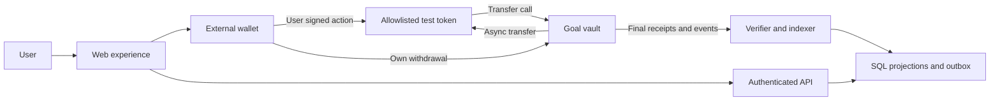

# Blockchain architecture

**Status:** Draft | **Version:** 0.1 | **Last updated:** 2026-11-14  
**Responsible role:** Smart-contract / security lead

## Purpose

Compare custody options and show the conditional vault design.

## Assumptions and dependencies

This is a documentation proposal, not an implemented or approved product. The master specification and owner approval govern scope. MVP means the proposed testnet release; later features require separate acceptance. Terms and shared states follow the [product requirements](../00-product/PRODUCT_REQUIREMENTS.md).

## Alternatives

| Option | Strength | Consequence |
|---|---|---|
| Wallet balance/metadata tracker | No goal-vault custody | Cannot enforce earmarking or prove purpose-specific balances |
| Contract-controlled per-user goal vault, recommended for review | Enforces attribution/withdrawal rules | Contract bugs, asynchronous settlement, storage cost and upgrade authority risk |
| Third-party custody/strategy | Familiar managed recovery possible | Provider control, insolvency, jurisdiction and operational exposure |

The diagram specifies option two conditionally. It does not choose custody or a legal classification.

On-chain: opaque goal identity, owner account, asset allowlist, accepted balances, reservations, operation deduplication, versioned events and bounded approved controls. Off-chain: names/categories/images, profile/consent, read models, points, notifications, support and analytics. No personal goal purpose or marketing data on-chain.

## Acceptance / failure boundaries

Every balance view includes network/asset/checkpoint. Indexer/provider is an observation source, not authority to create money. No backend signing key withdraws user assets. A full-access vault key can replace code, so its existence and governance must be disclosed. Network outage yields pending/unknown, never unverified success.

## Unresolved decisions

See the linked decision register; recommendations are not approvals.

## Related documents

- [Decision Register](../00-product/DECISION_REGISTER.md)
- [Requirements Traceability](../00-product/REQUIREMENTS_TRACEABILITY.md)
- [Architecture Decisions](../../ARCHITECTURE_DECISIONS.md)
- [System Architecture](../10-backend/SYSTEM_ARCHITECTURE.md)
