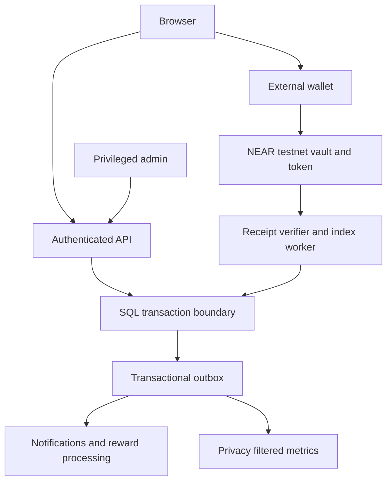

# System architecture

**Status:** Draft | **Version:** 0.1 | **Last updated:** 2026-11-14  
**Responsible role:** Backend / data lead

## Purpose

Define a maintainable conditional backend and data authority.

## Assumptions and dependencies

This is a documentation proposal, not an implemented or approved product. The master specification and owner approval govern scope. MVP means the proposed testnet release; later features require separate acceptance. Terms and shared states follow the [product requirements](../00-product/PRODUCT_REQUIREMENTS.md).

## Proposed components

One modular TypeScript application/API with a relational database and durable worker; exact framework, auth provider and hosting remain D18 decisions. Separate modules for sessions/identity, profile/consent, goal metadata, chain intents/verification, rewards, notices, admin/support and analytics. Rust vault remains a separately built/reviewed artefact. Do not add microservices merely for each module.

## Source-of-truth map

Profile/name/preferences and consent: SQL with owner/role controls. Wallet ownership proof: signature plus current account key evidence. Funds/reservations: final contract state/economic receipts. SQL balances/history: reconstructable verified projection. Points: immutable SQL reward ledger sourced from verified actions. Notifications: outbox/delivery evidence. Analytics: derived observation, never balance authority.

## Acceptance and failures

Database transactions atomically persist verified effects, idempotency records and outbox. RPC/indexer outages produce stale/unknown status; worker restart replays safely. Admin cannot submit financial authorisations as a user. Later yield adapters, group memberships and catalogue fulfilment remain inactive modules. Vendors need privacy, region, security, export, backup and operational assessment before selection.

## Unresolved decisions

See the linked decision register; recommendations are not approvals.

## Related documents

- [Decision Register](../00-product/DECISION_REGISTER.md)
- [Requirements Traceability](../00-product/REQUIREMENTS_TRACEABILITY.md)
- [Blockchain Architecture](../09-blockchain/BLOCKCHAIN_ARCHITECTURE.md)
