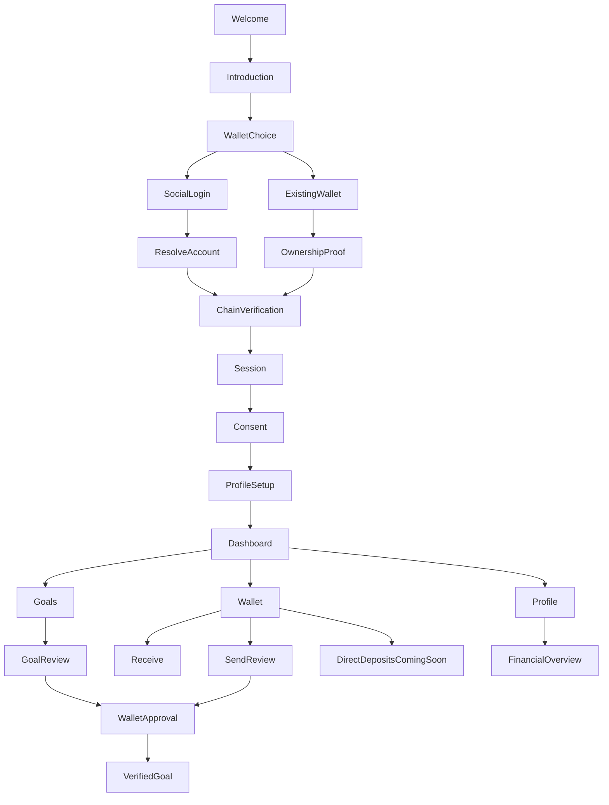

# Tinye connected application flows

Status: Proposed; owner approval pending. Version: 1.0. Updated: 2026-11-14.
Owner: Product and application engineering.

Purpose: connect the current screens without redesigning them. This supplements the [master specification](../Tinye_Master_Project_Specification.md), especially sections 4-12 and 26. The latest wallet/profile correction supersedes the earlier fictional bank-transfer credit request in [the demo proposal](20-payments/DEMO_BANK_TRANSFER.md).

## Scope and dependencies

Preserve the rendered light green-and-cream interface, current typography, responsive layout, navigation and animation. Earlier dark mockups in [design.md](../design.md) are historical references; wiring must not recolour the current application. Add missing destinations using existing cards, buttons and modals. Security states and truthful financial copy are necessary functional changes.

Dependency: approved wallet plan, operational testnet RPC, reviewed savings contract, authenticated backend and durable transaction tracking. No flow below is represented as implemented by this document.

## Nine required journeys and acceptance

| ID | Connected journey | Acceptance criteria |
|---|---|---|
| FLOW-01 | Existing welcome/introduction -> email, Google or Apple where supported, or existing wallet -> account creation/resolution -> account and signing-authority verification -> secure session -> versioned legal consent -> minimal profile -> dashboard | Returning login resolves the same verified account. No dashboard with seeded identity; rejected/failed/unknown setup remains recoverable. Marketing consent is separate. |
| FLOW-02 | Goals -> existing create form -> review -> wallet approval -> verified `create_goal` -> details | Draft is not an active chain goal; owner, target and request ID match final state before confirmation. Private name/notes stay off-chain. |
| FLOW-03 | Goal details -> Add funds -> amount -> review -> signing -> verification -> refreshed contract balance -> success -> explorer | Selected goal is carried through; attached native NEAR amount equals integer input. Wallet receipt alone is insufficient. Receiving into a personal wallet never credits a goal. |
| FLOW-04 | Goal details -> Withdraw -> eligibility -> review -> signing -> transfer/callback verification -> refreshed available/reserved balances -> confirmation | Nonowner/overdraw rejected by contract. Failed transfer releases reservation exactly once; unresolved settlement remains unknown and prevents duplicate payout. |
| FLOW-05 | Wallet -> actual account/network -> verified available wallet assets, separate savings -> Receive or Send -> history -> explorer | Receive QR encodes plain account ID. Wallet switching replaces QR/data. Send enabled only when signing, recipient validation and verification are operational. No fabricated aggregate fiat value. |
| FLOW-06 | Rewards -> eligible verified savings events -> points ledger -> milestone -> catalogue -> review -> redemption status | Rules and fulfilment approval required. Events credited once; reservation is not fulfilment. Unconfigured benefits are unavailable, with no fake gas sponsorship/NFT receipt. |
| FLOW-07 | Reputation -> verified history -> factor breakdown -> correction/help | Formula requires approval. Until then show history and an unavailable score, never seeded creditworthiness claims. |
| FLOW-08 | Groups -> create -> bounded invite -> authenticated join -> signed contribution -> verified member/group balances -> completion/member withdrawal | New scope requiring reviewed membership and fund rules. Recommended individually attributable shares; organiser cannot withdraw others' funds. No local-only contribution confirmation. |
| FLOW-09 | Profile -> wallet/security/preferences/notifications/legal -> session logout or account closure | All links open a destination or explicit unavailable state. Closure explains public-chain permanence and remaining savings; logout never deletes wallet or moves funds. |

## Wallet, profile and direct deposits

Profile financial overview has three independently sourced figures per asset: Wallet Balance, Total Savings, Total Withdrawn. Withdrawn means completed savings-contract withdrawals over an explicit time scope, not wallet sends or pending withdrawals. Never sum different assets without verified conversion data.

Wallet Receive shows actual account ID, plain-account-ID QR, copy/share where supported, network badge and this warning: "Only send assets supported by this wallet on the selected NEAR network. Sending assets on the wrong network may result in loss of funds."

At the existing bank/direct-funding entry show **Direct Deposits — Coming Soon** with disabled **Coming Soon** button and: "We're working on a simpler way to fund your Tinye account. For now, you can receive supported tokens directly into your connected NEAR wallet." Remove simulation execution and crediting; this does not disable a future verified savings-contract deposit.

## Shared states

Loading, empty, disconnected, wrong network, account provisioning, authentication rejected/expired, RPC unavailable, stale indexed data, insufficient funds and maintenance must be explicit. Financial states follow [TRANSACTION_LIFECYCLE](TRANSACTION_LIFECYCLE.md). Modal close or reload cannot cancel an already submitted transaction. Restore unresolved intents and query their outcomes.

## Outstanding decisions

Approve wallet architecture, flexible/native-NEAR/no-yield testnet rules, contract administrative powers, data host, reward rules, reputation formula and group withdrawal policy. These remain proposed, not silently approved by requesting UI wiring. See [gap analysis and phased plan](IMPLEMENTATION_GAP_ANALYSIS.md) and [screen matrix](SCREEN_WIRING_MATRIX.md).
