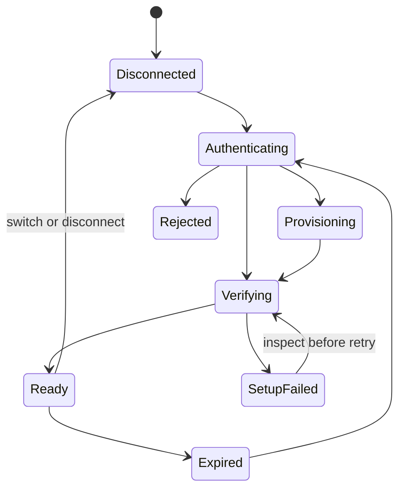

# NEAR wallet onboarding and authentication plan

Status: Proposed; integration approval pending. Version: 1.0. Updated: 2026-11-14.
Owner: Identity and security engineering.

Purpose: implement both user-owned embedded and existing-wallet onboarding under master sections 5, 11 and 15. Dependencies: provider compatibility tests, configured callback origin, session persistence, working testnet RPC and approved implementation plan. Application code is unchanged during this review.

## Audit

`src/app/providers.tsx` wraps only AppProvider. Installed FastAuth packages are not wired. `OnboardingWelcome.tsx` stores a local wallet selection and invokes `onComplete`; its existing Sign in action bypasses authentication. `AppContext.tsx` starts from `INITIAL_USER`, including a seeded testnet account. Local storage onboarding flags are not an authentication mechanism. No server authentication/session routes exist in `src/app`.

## Proposed provider decisions

| Path | Proposed implementation | Evidence and limits |
|---|---|---|
| Email/social | NEAR Auth using `@fast-auth-near/react-sdk` 1.3.1 and `@fast-auth-near/javascript-provider` 1.4.1, matching installed package declarations and registry versions checked today | [Official NEAR Auth guide](https://docs.near.org/web3-apps/tutorials/near-auth). Login and derived public key do not prove account activation. |
| Existing wallet | `@hot-labs/near-connect` 0.12.0, registry version checked today; use wallet capability/network filtering | [Official connector guide](https://docs.near.org/tools/near-connect) recommends NEAR Connect over deprecated Wallet Selector. HOT is a supported wallet, not a guarantee every wallet supports testnet/message signing. |
| Chain API | Audit current near-api-js v7 imports and pin a compatible version after a signing spike | Do not paste older `connect()` examples into v7 without checking exports and provider compatibility. Existing FastAuth dependencies include older NEAR SDK copies. |

Versions are observed candidates, not compatibility-test results. No package upgrade is performed by this document.

## Testnet configuration and account creation

[Official testnet resources](https://docs.auth.near.org/resources/testnet), accessed 2026-11-14, publish `fast-auth.testnet`, `jwt.fast-auth.testnet`, `auth0.jwt.fast-auth.testnet`, MPC `v1.signer-prod.testnet`, RPC `https://rpc.testnet.near.org`, and development Auth0 domain `login.testnet.fast-auth.com`. Use published development client configuration; browser client ID is public, server credentials are not. Confirm allowed local/staging callback origins and enabled email/Google/Apple connections. Do not offer an unavailable identity method as working.

Provisioning algorithm:

1. Authenticate via provider-approved browser flow with state/nonce and safe redirect validation. Resolve stable issuer/guard and subject, never use email alone as identity.
2. Derive or resolve identity-specific Ed25519 public key using the provider. Resolve an existing verified account binding first. New account provisioning uses an explicit sponsored activation request, bounded by account/rate limits; no shared administrator wallet assigned to users.
3. Prefer the provider-supported account activation flow. If it supplies only a derived key, a separately approved sponsor may activate the corresponding implicit account through NEAR's supported funding mechanism; the public-key/account mapping must be verified. Exact SDK activation support is a mandatory spike result, not assumed here.
4. Read `view_account` at finality and verify the expected key permission with `view_access_key`/access-key list. Verify a supported ownership proof or an explicit testnet transaction. Wrong account/key/network blocks readiness. A derived address, database row or JWT alone is insufficient.
5. Idempotently bind `(network, account_id)` to authenticated profile and issuer/subject. Existing binding conflicts require authenticated recovery/linking, not takeover through matching email.

No raw seeds/keys in Tinye database, frontend logs, analytics or conversation. Deployment wallet may sponsor bounded setup but must never derive or own user wallets. Account existence does not imply enough spendable gas.

## Signing, authentication and sessions

External wallets must support testnet, transaction signing and the chosen authentication proof. Use [NEP-413 backend authentication](https://docs.near.org/web3-apps/backend/backend): server-generated 32-byte random single-use nonce, exact recipient/origin, account/network binding, short expiry and atomic consumption. Verify signature and current on-chain full-access key authority. Reject replay, altered recipient, expired nonce, wrong network and revoked key. Unsupported message signing must show an unavailable authentication option unless a separate reviewed proof is implemented.

For NEAR Auth, do not assume NEP-413 support: verify capability in the spike. If unavailable, use a separately reviewed, domain-bound on-chain challenge proof. Validate provider authentication server-side and bind it to independently verified account authority; do not trust browser assertions of completion.

Create opaque random server-side session IDs; store hashes, user, wallet/network, creation/expiry/revocation and auth strength. Use HttpOnly, Secure in deployed HTTPS, SameSite cookies, CSRF/origin protection, rate limits and session rotation. Proposed idle expiry 30 minutes and absolute expiry 24 hours require security approval. Do not persist bearer tokens in localStorage. Never log provider JWTs or signature-request credentials.

Account/network switch invalidates the old session and clears account-scoped queries, QR, drafts and pending signing context before a new proof. Preserve submitted intents under their original signer, for reconciliation only. Disconnect revokes server session and connector state; logout also clears provider login as supported. Backend actions recheck session wallet binding; frontend button guards alone are insufficient.

## Recovery, custody and cost model

NEAR Auth [MPC documentation](https://docs.auth.near.org/protocol/concepts/mpc) describes identity-scoped distributed signing. Recovery depends on identity-provider recovery, guard configuration and MPC availability. Do not claim seed export, independent recovery or unconditional noncustody without demonstration. Explain risks of identity compromise, provider outage and administrator/upgrade powers. External-wallet recovery belongs to that wallet; Tinye never requests recovery phrases.

Costs include activation funding, storage, gas, MPC/guard signing and possible relayer fees. No zero-cost promise or invented quote. Record actual testnet measurements and sponsor budgets before enabling provisioning broadly. Mainnet requires approved credentials and separate custody, legal, cost and launch review; shared testnet credentials must not ship to mainnet.

## Acceptance and unresolved gates

- AUTH-01: Two identities resolve distinct accounts; repeat login restores the same account; neither account is the deployment account.
- AUTH-02: Testnet account/key queries and a user-authorised transaction pass; absent account remains setup pending.
- AUTH-03: Forged/replayed/expired/wrong-origin proofs and unbound account claims fail server-side.
- AUTH-04: Switch/disconnect/revocation prevents old account operations; QR and balances update without stale identity leakage.
- AUTH-05: Provider cancellation/outage/recovery are tested; callback allowlist, enabled login methods, custody limits and measured fees documented.
- AUTH-06: No dashboard seeded address/balance, no recovery phrase form, no signing secrets in logs or database.

Open: approve this dual-path choice; prove provider activation and proof APIs; select durable session/database host; approve sponsorship budget and provider recovery disclosures. Current local DNS failure prevents RPC and live end-to-end validation. [Flows](APP_FLOW.md), [transaction lifecycle](TRANSACTION_LIFECYCLE.md), [deployment report](TESTNET_SETUP_REPORT.md).
