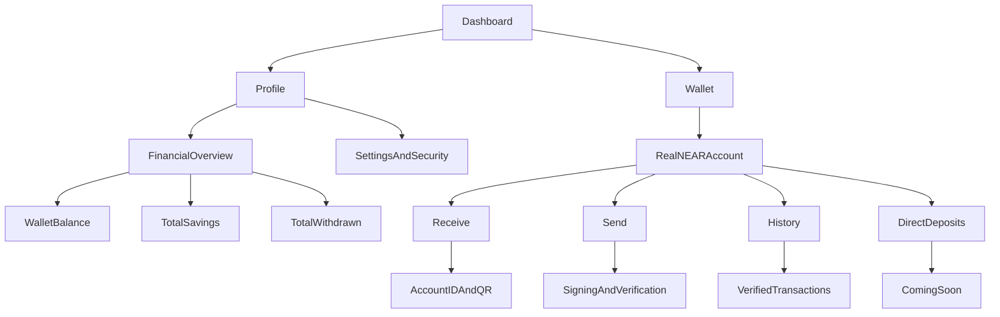

# Screen and action wiring matrix

Status: Proposed. Version: 1.0. Updated: 2026-11-14.
Owner: Application engineering and QA.

Purpose: inventory current interaction families and missing destinations against master section 4. Dependencies: [wallet plan](NEAR_WALLET_INTEGRATION.md), [flows](APP_FLOW.md) and [transaction lifecycle](TRANSACTION_LIFECYCLE.md). Repeated mapped buttons share a row; all instances require identical behaviour. Preserve existing classes, graphics, breakpoints and animation while replacing handlers/data.

## Existing screens and controls

| ID | File/screen and visible action | Current behaviour | Required connection and acceptance |
|---|---|---|---|
| UI-01 | OnboardingWelcome: Get started | Local step 1 -> 2 | Preserve step transition; FLOW-01 |
| UI-02 | Onboarding: introduction Continue/Back | Local steps | Preserve navigation and draft; no authentication claim |
| UI-03 | Onboarding: Already have an account? Sign in | Calls completion directly | Launch returning authentication; block dashboard until AUTH-01/03 |
| UI-04 | Onboarding: wallet option cards | Local demo/testnet selection | Email/social where configured; Connect Existing Wallet using capability-filtered NEAR Connect |
| UI-05 | Onboarding: terms/risk checkboxes | Local booleans | Link real versioned documents; server consent version/time; no invented compliance badge |
| UI-06 | Onboarding: completion button | Opens dashboard | Verify account/key/session/consent, persist profile; AUTH-02 |
| UI-07 | AppShell: desktop Home, Goals, Activity, Rewards, Profile | Local activeTab | Preserve destinations; authenticated account-scoped queries and loading states |
| UI-08 | AppShell: mobile Home, Goals, Save, Rewards, Profile | Tabs; Save opens deposit | Preserve layout; Save opens reviewed savings deposit flow, wallet guard |
| UI-09 | AppShell/header: Restart Onboarding | Resets local flag | Replay introduction only; never impersonate login/logout or delete wallet |
| UI-10 | AppShell: Help; Admin Audit | Local view | Help destination retained; admin requires server role, otherwise unavailable |
| UI-11 | Home: new/create goal controls | Opens CreateGoalModal | Existing form -> review -> signed creation; FLOW-02 |
| UI-12 | Home: goal rows | Opens selected object snapshot | Load detail by goal ID/account; refresh from chain, not stale object |
| UI-13 | Home goal detail: Add funds | Opens deposit and sets action goal | Carry selected goal into modal on each open; FLOW-03 |
| UI-14 | SavingsSummary: Withdraw | Opens withdrawal modal | Select/carry goal, run on-chain eligibility; FLOW-04; add goal-detail entry in existing style |
| UI-15 | Home: help action | Opens HelpModal | Preserve; content describes actual readiness |
| UI-16 | Goals: All/Active/Completed filters | Filters seeded state | Filter verified goal lifecycle; empty/error/stale distinguished |
| UI-17 | Goals: New goal | Opens create modal | Same as UI-11 |
| UI-18 | Goals: row/detail Add funds | Opens modal without selected goal handoff | Persist clicked ID, re-read ownership; no default-first-goal error |
| UI-19 | Home/Goals detail: Close | Closes modal | Preserve close; pending chain operation continues tracking |
| UI-20 | CreateGoalModal: category options | Local form value | Preserve all categories as private metadata |
| UI-21 | CreateGoalModal: name/target/date/notes and submit | Creates local active goal, closes | Strict target units, validation, review, signature and verified goal; TX-02 |
| UI-22 | CreateGoalModal: close/cancel | Dismiss | Preserve draft policy; never cancel submitted chain call silently |
| UI-23 | DepositModal: Bank transfer method | Opens DemoBankTransferModal | Existing funding entry -> Direct Deposits Coming Soon; disabled action, no credit |
| UI-24 | DepositModal: NEAR contract method | Local amount step | Guard verified signer, testnet and deployed reviewed contract |
| UI-25 | DepositModal: goal/amount selectors -> Review | Floating-point local input | Exact base-unit parsing and selected goal; query balance/gas/storage |
| UI-26 | DepositModal: confirm/sign | Fabricated successful client receipt | Real wallet call, durable intent, TX-01..06; never optimistic confirmed amount |
| UI-27 | DepositModal: success receipt/explorer | Fake hash/block values | Actual evidence only; network-allowlisted explorer; refresh goal and wallet |
| UI-28 | DepositModal: close/done | Dismiss | Preserve visuals, reset draft on new operation; continue reconciliation |
| UI-29 | WithdrawModal: goal/amount/MAX | Float values | Read eligible principal/reservations; exact units; MAX excludes unavailable funds |
| UI-30 | WithdrawModal: submit | Fake call, no separate review | Add review within current modal style, then wallet signing and callback settlement |
| UI-31 | WithdrawModal: success/close | Immediate fake confirmation/dismiss | Confirm only economic settlement; real hash/explorer; FLOW-04 |
| UI-32 | DemoBankTransferModal: country/currency/goal/amount | Fake bank references and rates | Remove transactional controls from active direct-funding flow; retain Coming Soon location |
| UI-33 | DemoBankTransferModal: I have sent it | Timer credits same savings goals | Delete/disable simulation path; no intent, receipt or balance mutation; FLOW-05 |
| UI-34 | DemoBankTransferModal: back/copy/done/close where rendered | Local state/clipboard | No payable account details; native Coming Soon dismissal only |
| UI-35 | SavingsSummary: Save/Withdraw/Help and balance labels | Opens corresponding modals; seeded/mixed demo values | Preserve entry points; verified contract values only; unavailable/stale instead of invented totals |
| UI-36 | Activity: All/Deposit/Withdrawal/Demo filters | Local transactions | Verified typed history; remove production demo entries; wallet vs savings distinguished |
| UI-37 | Activity: transaction row | Opens local receipt | Evidence-backed detail: asset, amount, sender/recipient, status, time, hash and explorer |
| UI-38 | Activity receipt: Close/Done | Dismiss | Preserve; TX-05; hash visible only when obtained |
| UI-39 | Rewards: Milestones/Catalogue tabs | Local subtab | Preserve tabs; eligible event ledger / configured catalogue query |
| UI-40 | Rewards: Claim milestone | Seeded bool awards local points | Server verifies eligible chain evidence; atomic unique claim; FLOW-06 |
| UI-41 | Rewards: Redeem | Random receipt, immediate fulfilment toast | Review, reserve points, fulfil real configured benefit, refund on failure; unavailable until approved |
| UI-42 | Profile: header/wallet/security/consent display | Static mock account and compliance/custody claims | Actual profile/account/network; provider-specific disclosure and recorded consent only |
| UI-43 | Admin: invariant displays | Same local value compared to itself | Independent chain backing/liability queries; stale/error; never claim audited or 100% backed from local sums |
| UI-44 | HelpView/HelpModal: close/Got it and informational content | Local content | Preserve controls; reflect actual provider recovery and limitations |
| UI-45 | Global modal close/back/select/input controls | Local state | Preserve keyboard/focus/escape behaviour; closing never fabricates chain cancellation |

## Missing destinations and additive wiring

| ID | Destination/action | Required result |
|---|---|---|
| UI-46 | Wallet page, accessible from Profile and existing navigation conventions | Actual account/status/network, per-asset wallet balances, separate contract savings, refresh, explorer, switch/disconnect |
| UI-47 | Receive -> copy/share | Actual account-ID QR; clipboard/share feedback; disconnected Connect Wallet; replace QR on switch |
| UI-48 | Wallet Send/Withdraw -> select asset/recipient/amount/review/sign | Enable only after TX-01..06; otherwise explicit Coming Soon. Separate from savings withdrawal |
| UI-49 | Wallet history -> detail/explorer | Verified wallet received/sent and contract interaction types; coverage scope and pagination |
| UI-50 | Profile financial overview | Wallet Balance / Total Savings / Total Withdrawn per asset and stated scope, without double counting |
| UI-51 | Profile: My Wallet / Savings Goals / Transaction History / Rewards | Actual wallet/goals/activity/rewards destinations |
| UI-52 | Profile: Savings Reputation | Verified history and approved factor breakdown; unavailable score until formula approved |
| UI-53 | Profile: Security | Sessions, provider recovery guidance, wallet management; no seed phrase fields |
| UI-54 | Profile: Notifications / Preferences | Persisted opt-in/preferences or clearly unavailable; permissions requested contextually |
| UI-55 | Profile: Help / Terms / Privacy / Risk | Actual help/versioned draft documents with review status; no false legal approval |
| UI-56 | Profile: Disconnect / Log Out | Revoke session and clear signer-scoped caches; AUTH-04 |
| UI-57 | Profile: account closure | Review pending transactions/balances, data retention/export; no deletion of chain history |
| UI-58 | Profile setup/edit | Minimal display name/avatar/email if available; protected backend persistence |
| UI-59 | Groups: create/invite/join | New destinations with current components; membership proof, expiry and approved permissions |
| UI-60 | Groups: contribute/activity/complete/withdraw | Verified member shares; no organiser appropriation; FLOW-08 |
| UI-61 | Goal edit/history, reward details/review/points history | Supplement existing modals/views; distinguish private edits from signed financial-rule changes |
| UI-62 | Yield/strategy screens listed by master | Unavailable; no yield source approved, no invented APY |
| UI-63 | Marketing, auth verification/retry, wallet setup success, notification prompt and global errors | Existing onboarding/modal patterns; no false completion; master inventory remains acceptance baseline |

## Matrix acceptance and open items

QA must enumerate every rendered instance of these action families, test tab/keyboard/mobile activation, check real destination or explicit unavailable state, and attach evidence to FLOW/AUTH/TX IDs. No enabled financial button may return a fabricated success. New destinations need layout review using existing components, not a new design system. Provider, contract and rewards/group rule decisions remain open in [gap analysis](IMPLEMENTATION_GAP_ANALYSIS.md).
