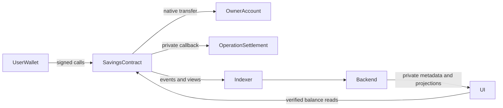

# Savings contract architecture and deployment gate

Status: Proposed; not deployment-ready. Version: 1.0. Updated: 2026-11-14.
Owner: Contract and security engineering.

Purpose: supplement master section 11 and [existing contract requirements](09-blockchain/CONTRACT_REQUIREMENTS.md). Dependencies: savings-rule approval, reviewed Rust implementation, current toolchain, unit/sandbox tests and separate explicit deployment approval.

## Existing implementation and proposed boundary

`contracts/tinye_vault` contains `initialise`, `create_goal`, `deposit_native`, `withdraw`, private `settle_withdrawal`, `get_goal`, `get_operation` and `get_vault_totals`. This is source code, not evidence of a compiled or deployed contract. Cargo is unavailable on PATH in the audit environment. `near-sdk = "5.5.0"` is a semver requirement, not a verified installed version; no lockfile establishes resolution. Production dependencies enable `unit-testing`; build features/legacy collections need review.

Prioritise one savings contract on a dedicated testnet account. Do not deploy rewards or identity contracts unnecessarily: NEAR Auth uses provider contracts. No rewards contract requirements are approved. Group support may extend the savings contract after fund rules are approved, rather than adding another custody boundary by default.

Recommended first testnet product for approval: native NEAR only, flexible owner withdrawals, no strategy/yield/platform fee/penalty. Target date is informational. Reaching target must not unexpectedly prevent new contributions or withdrawals. Any committed mode or FT requires separate rules and tests.

## Proposed state and interface changes

The signatures below are interface proposals, not existing SDK APIs. Final ABI and argument names must be checked against the compiled reviewed contract before client wiring.

| Method | Proposed arguments/result | Permission |
|---|---|---|
| initialise | owner_id, explicit policy/config version | Once only; deployed configuration verified |
| create_goal | goal_id, target:U128, request_id; bounded paid storage | Predecessor owns new goal; positive target; owner-scoped unique ID |
| deposit_native | goal_id, request_id; attached principal | Goal owner; native asset; positive amount; deposits not paused |
| withdraw | goal_id, amount:U128, request_id; approval deposit | Goal owner only; amount within eligible unreserved liability |
| settle_withdrawal | operation_id, callback nonce | Private callback only; matching pending operation and actual promise result |
| get_goal / list_goals | owner and bounded cursor/limit | Public monetary state; no private names/notes |
| get_operation | owner, request_id | Public settlement evidence |
| get_vault_totals | per-asset liabilities/reserved/storage accounting | Public; not a substitute for independent account backing check |
| set_deposits_paused | flag, reason | Approved owner role; events; no arbitrary fund transfer |

Existing global goal IDs, operation fields and asset sentinel must be migrated or replaced before deployment; do not assume the above ABI already exists. No live migration is authorised.

State: goal owner, opaque goal ID, native asset identifier, target, principal liability, reserved withdrawal amount, policy version and explicit lifecycle. Operation: owner, request ID, kind, payload hash, goal, amount, state, callback nonce and settlement evidence. Store per-owner bounded indexes and bounded request/event metadata. Private profile, email, goal name/notes and invite tokens belong in authenticated backend storage.

Charge or cap storage growth using measured storage usage; separately account refundable storage deposits. [Official storage guidance](https://docs.near.org/smart-contracts/security/storage) warns that unbounded user-funded state consumes contract resources. Do not pay arbitrary unbounded user storage from savings backing. [One-yocto guidance](https://docs.near.org/smart-contracts/security/one_yocto) informs withdrawal approval-key requirements; it never replaces ownership checks.

## Permissions and invariants

Users control only their own goal principal. Backend/indexer cannot alter contract balances. Owner may pause new deposits only under approved rules; withdrawals remain available unless an explicitly reviewed emergency policy says otherwise. Owner/treasury fields do not authorise arbitrary withdrawal of user liabilities. Deployment key can upgrade code while retained; disclose that authority, restrict/rotate it and do not claim immutable custody. Do not remove recovery/access keys without a separately reviewed operational plan.

- CONTRACT-01: `0 <= reserved <= liability`; available equals liability minus reserved.
- CONTRACT-02: Vault liability equals sum of goal liabilities, separately per asset; reserved equals pending withdrawal amounts.
- CONTRACT-03: Spendable backing, excluding storage-locked and operational reserves, covers liabilities; admin view compares independent chain values.
- CONTRACT-04: Deposits increase liability exactly by accepted principal; successful withdrawals reduce exactly once; failed transfers release reserve once.
- CONTRACT-05: Request replay cannot retain attached NEAR without credit, duplicate credit, or pay twice. Reject conflicting payload reuse.
- CONTRACT-06: Nonowners, external callback callers, unsupported asset and arithmetic overflow fail without state corruption.

Existing callback uses saturating subtraction and lacks explicit pending-state/payload/nonce guards; recovery after callback failure is unspecified. Strengthen before deployment. Do not infer that an external caller can presently invoke a private callback.

## Events, groups and testing

Emit versioned NEP-297-style `EVENT_JSON` envelopes for goal_created, deposit_settled, withdrawal_requested, withdrawal_settled and withdrawal_failed. Data includes opaque operation/goal IDs, owner, asset, amount base-unit string and policy version, never private metadata. Indexer uniqueness uses network/contract/receipt/log/event index; reward eligibility references verified settlement, not clicks.

Group extension proposal: explicit on-chain member shares, user-authorised join/contribution and withdrawals limited to each member's shares. Invite secrets and display metadata remain private. Organiser cannot spend member funds. Completion, departure and membership revocation rules require approval before coding ABI or deployment.

Run unit and sandbox integration tests for the invariants, concurrent withdrawals, failures/callback recovery, replay with attached funds, pause behaviour, gas exhaustion, storage spam, bounded pagination and account permission changes. Build using current cargo-near workflow, pin lockfile/toolchain and hash WASM. Record compiler, SDK, source manifest, tests, artifact SHA256 and deploy/init configuration. Deployment remains blocked until these pass and the owner explicitly approves the exact artifact/account/configuration. See [setup report](TESTNET_SETUP_REPORT.md).

Open: administrative upgrade/recovery policy, storage payer, limits/gas, groups, reward rules. [Transaction lifecycle](TRANSACTION_LIFECYCLE.md) governs client settlement.
