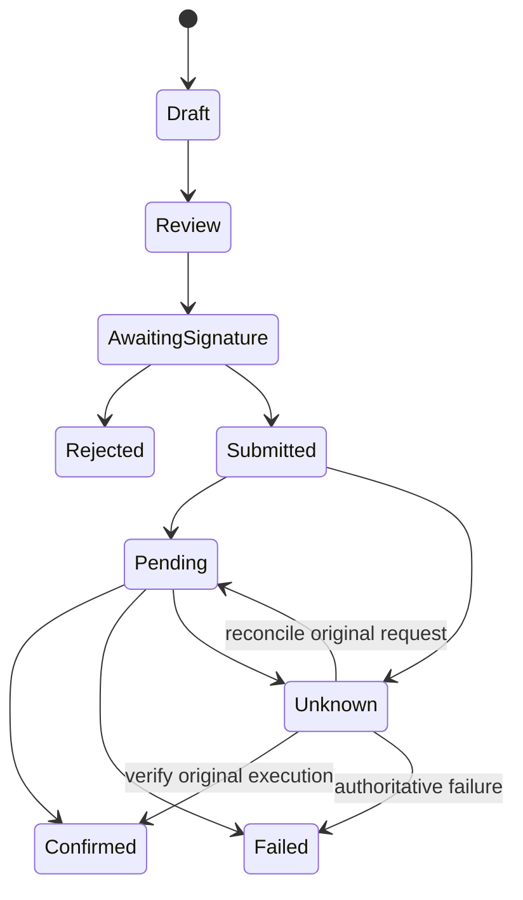

# Transaction verification and reconciliation

Status: Proposed. Version: 1.0. Updated: 2026-11-14.
Owner: Blockchain and backend engineering.

Purpose: define auditable financial states under master sections 6, 11 and 12. Dependencies: verified wallet binding, reviewed deployed contract, durable intent store, testnet RPC. Current fake contract client must be replaced after plan approval; no transaction has been verified by this documentation exercise.

## Common record and verification

Persist intent ID, authenticated owner, network, receiver/contract, method, goal ID, asset ID, decimal amount as base-unit string, request ID, exact payload hash, signer, transaction/receipt IDs, creation/update times, state and evidence block hash/height. Use a cryptographically random intent/request ID, scoped by owner and operation; no random fake chain hash. Store attempts separately from economic operations.

Decimal parsing is strict: no exponent, negative/NaN/infinity or excess decimal places. Native NEAR has 24 decimal places; use BigInt locally and decimal strings in JSON. Contract values use checked u128. Do not use `parseFloat`, multiplication by `1e24`, two-decimal rounding or `Number` for accounting. Reject excess precision rather than silently truncating savings principal.

Verify network, signer, receiver, method, attached amount and arguments against the intent. Query [official transaction RPC](https://docs.near.org/api/rpc/transactions) through the execution completion/finality required for all relevant receipts. Check failures in receipt outcomes, not only root transaction status. For savings mutations query operation and goal state at a known final block at or after execution. Mark confirmed only when expected economic settlement matches. An explorer URL or wallet popup success is not proof.

## Operation-specific rules

| Operation | Authorisation and submission | Required economic evidence |
|---|---|---|
| Goal creation | Owner wallet signs reviewed `create_goal`; storage funding separately disclosed | Goal exists for signer with correct asset/target/request; only then active |
| Savings deposit | Owner signs `deposit_native`, exact attached principal, storage handling explicit | Settled operation plus goal and vault liability increase; storage fees are not principal |
| Savings withdrawal | Owner signs request with required approval deposit; contract reserves eligible balance before transfer | Transfer receipt succeeds and private callback settles matching pending operation; only then withdrawn totals increase |
| Personal wallet send | Owner wallet signs native transfer to validated NEAR recipient; FT only when configured/reviewed | Final successful transfer with correct signer/receiver/asset/amount; refresh wallet, never decrement savings |
| Receive | No Tinye transaction initiation; plain account-ID QR/copy | Verified incoming transfer attributed to account, separately classified from savings deposits |
| Direct account deposit | Coming Soon, disabled | No intent, transaction, simulated receipt or balance mutation |

Storage registration and FT transfer requirements must be implemented per [FT standard](https://docs.near.org/primitives/ft/standard) only after asset approval. Incoming FT transfers cannot be inferred from native-NEAR amount fields.

## Failure, concurrency and unknown outcomes

Wallet rejection before submission is rejected, not chain failure. RPC timeout after submission is unknown; do not automatically resubmit a new transfer. Recover original hash using wallet result, signer/nonce evidence and contract request lookup. Unknown without a hash remains unresolved; do not claim failure from absence in an eventually consistent indexer. A new attempt needs reconciliation and explicit user action.

Same intent replays return its existing result. Conflicting payload for an existing request ID is rejected. A duplicate deposit with attached value must be rejected/refunded, never silently kept without credit. Withdrawal callback checks operation state, amount, goal, owner and nonce before releasing reserve or reducing liability exactly once. Callback failure after a successful transfer requires reviewed recovery based on receipt evidence; timeout alone must never release reserved funds and permit double payment.

Persist across refresh, tab close and reconnect. Track concurrent withdrawals against on-chain available liability minus reservations. Indexer outages show stale/pending evidence and trigger bounded retry with backoff; they cannot overwrite chain truth. Backend reconciliation reads, it does not sign user transfers.

## Projection and user experience

Financial cards display token quantities per asset with network, evidence timestamp/block and loading/error/stale states. Never replace an unavailable value with zero or seeded 14.50 NEAR. Optimistic UI can show a pending amount separately; confirmed balances change only from verified chain state. Total Withdrawn uses successful settled savings withdrawals, deduplicated by operation and scoped by asset/account/network/date; wallet sends and gas are excluded.

History uses an indexer plus independent evidence checks for native receipts, FT events and Tinye events. Distinguish wallet received/sent, savings deposit/withdrawal and other interactions; one transaction with multiple receipts cannot be counted twice. Cursor pagination, partial-history warnings and coverage start time are required. Proposed explorer bases: testnet `https://testnet.nearblocks.io`, mainnet `https://nearblocks.io`; allowlisted account/transaction paths only. Mainnet remains disabled.

## Acceptance

- TX-01: Rejection, execution failure, timeout/unknown, delayed indexer and successful settlement each render correctly.
- TX-02: Duplicate click, reload and replay cannot double-credit or double-withdraw.
- TX-03: Wrong signer/network/contract/amount and failed child receipt cannot produce confirmation.
- TX-04: One yoctoNEAR, 24-place inputs, excess precision, overflow and concurrent reservations are tested.
- TX-05: Balance deltas reconcile to settled principal; gas/storage are separate; receipt links match the actual network.
- TX-06: Switching wallet during signing cannot redirect a prepared transaction or show old balances under the new identity.

Open: exact gas budgets from tests, intent retention, indexer host/coverage and callback-recovery authority. Related: [contract design](SMART_CONTRACT_ARCHITECTURE.md), [wallet integration](NEAR_WALLET_INTEGRATION.md).
